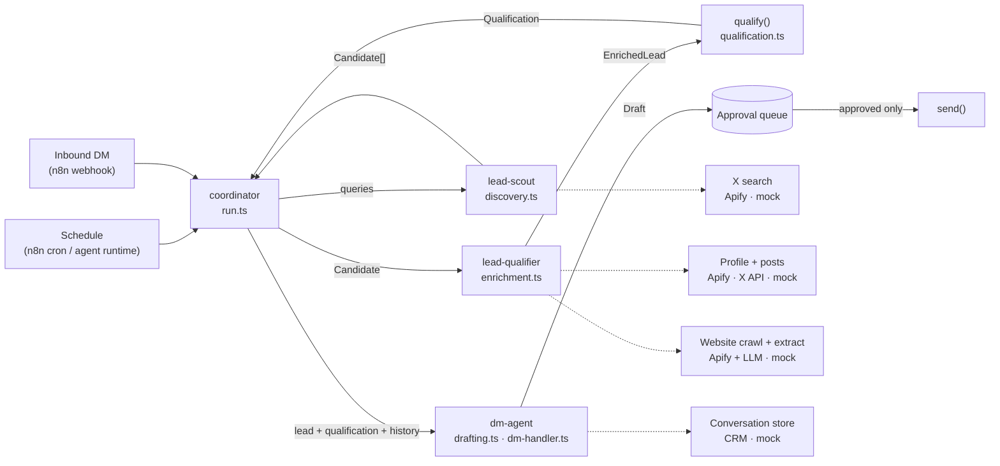

# AI acquisition reference

A small, runnable reference for an AI-assisted B2B acquisition system on X: find prospects, research them, qualify them on evidence, recommend the next move, draft the message, and hold everything for human approval. It handles inbound DMs the same way.

> **Reference implementation.** This is a sanitised, self-contained version built for sharing. Every person, handle, company, domain and conversation is fictional (domains use the reserved `.example` TLD). All data is local mock data. Nothing calls an external service and nothing is ever sent.

## Quick start

```bash
npm install
npm run demo                              # outbound: discover → qualify → rank → draft
npm run demo:inbound                      # inbound DM: history → qualify → state → draft reply
npm run demo:inbound -- --interactive     # approve / edit / reject the draft yourself
npm run demo:inbound -- --json            # machine-readable result (what n8n would consume)
npm run typecheck
```

Node 18+. Three dev dependencies (`tsx`, `typescript`, `@types/node`), no runtime dependencies. Output is deterministic: the clock is fixed and all data is local. Results are written to `out/`.

## What it demonstrates

| Capability | Where |
|---|---|
| X lead discovery from listening queries, with dedupe, stale-post and suppression filters | `src/discovery.ts`, `agents/lead-scout.md` |
| Profile, recent-post and website/company enrichment | `src/enrichment.ts` |
| Signal-based qualification: 12 positive, 9 negative signals, 2 hard gates, each with evidence | `src/qualification.ts`, `context/QUALIFICATION-SIGNALS.md` |
| 0–100 score → HIGH / MEDIUM / LOW / REJECT, plus confidence | `qualify()` |
| Next action (`dm` / `comment` / `monitor` / `reject`) and outreach angle | `qualify()` |
| Outreach and reply drafting | `src/drafting.ts`, `agents/dm-agent.md` |
| Inbound DM handling with conversation history and state | `src/dm-handler.ts`, `workflows/inbound-dm.md` |
| Human approval enforced in code, not in a prompt | `ApprovalQueue`, `send()` |
| Coordinator / specialist agent pattern | `agents/`, `src/run.ts` |
| Apify-style adapters you can swap in | `ApifyXSearch`, `ApifyCompanySource` |

## Architecture



Four rules hold the design together (more in [ARCHITECTURE.md](ARCHITECTURE.md)):

1. **Models find evidence; code does the scoring.** Signals carry a quote or a number. The score is a weighted sum in TypeScript, never a number a model made up.
2. **Approval is a code path.** `send()` throws unless a human approved the item. A prompt saying "always ask first" is not a control.
3. **Filter before you spend.** Dedupe, suppression and staleness checks run before any paid enrichment.
4. **Adapters at the edges, typed objects in the middle.** Swapping mock for Apify changes one constructor, not the pipeline.

## How an outbound run works

```
discover → filter → enrich profile + posts → enrich website → signals → score → tier → rank → action → draft → approval queue
```

From the demo:

```
1. discover   5 queries → 10 hits → 7 candidates (1 duplicate, 1 stale, 1 suppressed)
2. enrich     7 profiles, 12 posts, 6 websites
3. qualify    4 kept, 3 rejected
4. draft      3 drafts queued for human approval (out/approval-queue.json)

#  HANDLE                  SCORE  TIER    CONF    ACTION   COMPANY
1  @mara_hollis            94     HIGH    high    dm       Ledgermoor
2  @teodor_lind            88     HIGH    high    comment  Harbourgrain Data
3  @jenna_kowal            68     MEDIUM  medium  comment  Pinglattice
4  @sofia_reyes_cfo        44     LOW     low     monitor  Varrowby Finance
5  @lena_marsh             37     REJECT  medium  reject   Ovenmere Bakehouse
6  @example_spam_bot_01    —      REJECT  high    reject   —
7  @kai_buildsfocus        —      REJECT  high    reject   Focusrill
```

Each kept lead prints its signals with evidence, the reasoning, the outreach angle and the draft. See [workflows/outbound-run.md](workflows/outbound-run.md) for why each lead lands where it does, and [examples/example-qualified-lead.json](examples/example-qualified-lead.json) for the full output shape.

## How inbound DMs work

```
DM received → identify sender → history → profile → company → qualify → conversation state → draft → approval → log
```

Inbound senders go through the same enrichment and scoring as outbound leads. The dm-agent then reads the conversation state (`reengaged`, `pricing_question`, `spam`, …), works out what they're asking, and drafts a reply grounded in the history. Spam gets no draft. The worked example in [workflows/inbound-dm.md](workflows/inbound-dm.md) follows a founder who deferred in November and came back in March asking about price.

## Directory structure

```
├── README.md                     you are here
├── ARCHITECTURE.md               design decisions, agent ↔ code map, production mapping
├── .env.example                  where real credentials would go (none needed for the demo)
├── context/
│   ├── ICP.md                    fictional ICP and listening phrases
│   └── QUALIFICATION-SIGNALS.md  signal weights, tiers, action rules (mirrors the code)
├── agents/                       operational instructions for each agent
│   ├── coordinator.md
│   ├── lead-scout.md
│   ├── lead-qualifier.md
│   └── dm-agent.md
├── src/
│   ├── types.ts                  data contracts + adapter interfaces
│   ├── mock-data.ts              the fictional world
│   ├── discovery.ts              lead-scout: search, dedupe, suppress
│   ├── enrichment.ts             lead-qualifier: profile, posts, company
│   ├── qualification.ts          signals → score → tier → action → angle
│   ├── drafting.ts               dm-agent: comments, DMs, replies
│   ├── dm-handler.ts             inbound pipeline, approval queue, send gate, log
│   └── run.ts                    coordinator / CLI entry point
├── workflows/
│   ├── outbound-run.md
│   └── inbound-dm.md
└── examples/
    ├── example-lead.json             EnrichedLead (input to qualification)
    ├── example-qualified-lead.json   Qualification + draft (output)
    └── example-inbound-dm.json       inbound webhook payload
```

## Mocked here vs production

| Concern | In this repo | In production |
|---|---|---|
| X search | `MockXSearch` over a fixed index | Apify X search actor (`ApifyXSearch`) or X API search |
| Profiles + posts | `MockProfileSource` | Apify profile/timeline actor or X API |
| Company data | `MockCompanySource`, pre-structured | Apify website crawler → LLM extraction into `CompanyProfile` |
| Signal detection | Regex and field rules | Same hard rules, plus LLM extraction for the soft signals (`problem_fit`, `buying_intent`) |
| Scoring, tiers, actions | `qualify()` | Same code, unchanged |
| Drafting | Templates | LLM using `agents/dm-agent.md` + the same inputs |
| Conversation history | `MockConversationStore` | CRM or database, synced from X DMs |
| Approval | JSON file + optional CLI prompt | Slack / Telegram button, or an n8n wait node |
| Sending | `send()` prints `[MOCK SEND]` | X API v2 DM / reply endpoint, behind the same gate |
| Scheduling + triggers | `npm run` | n8n cron + webhook, or an agent runtime's scheduler |

## Connecting real infrastructure

None of this is required to run the demo.

- **Apify.** `ApifyXSearch` and `ApifyCompanySource` call Apify's `run-sync-get-dataset-items` endpoint. Set `APIFY_TOKEN` and the actor IDs in `.env`, then pass `ApifyXSearch` to `discover()` and `ApifyCompanySource` (with your extraction function) to `enrich()` in place of the mocks. Actor output fields vary, so adjust each class's mapping function. These two classes are written against the documented Apify API but **haven't been run against a live actor** in this repo.
- **X API.** Implement `ProfileSource` and `ConversationStore` against the X API v2 user, timeline and Direct Message endpoints. Point `send()` at the DM/reply endpoint. Keep the approval check where it is.
- **n8n.** n8n owns the plumbing, not the judgement. A cron trigger runs `npm run demo`-style jobs on a schedule. A webhook receives inbound DM events (payload shaped like `examples/example-inbound-dm.json`) and runs `run.ts inbound <file> --json` via Execute Command, or calls `handleInboundDm()` behind a small HTTP endpoint. A Slack/Telegram node posts the approval item, and a wait node resumes on the button press and calls `send()`.
- **Hermes or another agent runtime.** Load the files in `agents/` as agent instructions, `context/` as shared knowledge, and expose `discover`, `enrich`, `qualify`, `draftReply` and `ApprovalQueue.submit` as tools. The coordinator agent orchestrates. The scoring and the send gate stay in code either way.

The same qualification pipeline works for LinkedIn: swap the X channel adapters (`DiscoverySource`, `ProfileSource`, `ConversationStore`, `send()`) for LinkedIn ones and `enrich()`, `qualify()` and the approval gate stay as they are, though X-specific signal labels and activity thresholds would need relabelling.

## Deliberately not included

CRM sync, rate limiting and retries, multi-account sending, follow-up sequencing, a database, and analytics. They matter in production but they'd hide the core logic here.
